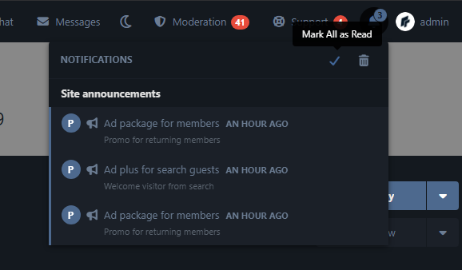

# PRM Notifications

Targeted site announcements shown inside the regular notifications bell — for new users, all members, and guests.

Compatible with **Flarum 2.0**.

## Screenshots

Announcements inside the notifications bell:



## What it does

- Admins create **campaigns** (title, message, optional link, start / end date)
- Each campaign picks its **audience**:
  - **New users** — registered within the last N hours (configurable, default 72)
  - **All members** — every logged-in user, including returning visitors (ad package)
  - **Guests** — any visitor who is not logged in, however they reached the site (ad plus package)
- Campaigns appear at the top of the core notifications dropdown under **Site announcements** and count towards the bell badge
- Guests normally have no bell; one appears for them while a guest campaign is active
- **Mark all as read** (✓) or clicking a campaign marks it read — it stays in the list but no longer counts as unread
- **✕** dismisses a campaign for that visitor permanently
- Read / dismissed state is stored per user, and per browser for guests

## Install

```bash
composer config repositories.prm-notification vcs https://github.com/smmpanelscripts1/prm-notification
composer require prm/notification:dev-2.x
```

Enable **PRM Notifications**, then:

```bash
php flarum migrate
php flarum cache:clear
```

## How to use

### Permissions (Admin → Permissions)

| Permission | Who |
| --- | --- |
| Manage site notification campaigns | Moderators |

### Campaigns

Go to **Admin → PRM Notifications**:

1. Set **New-user window (hours)** and save.
2. Fill in title, body, and optionally a link and start / end date.
3. Tick one or more audiences (**New registrations**, **All members**, **Guests**) and set **Active**.
4. **Save campaign**. Use **Edit** / **Delete** in the list below the form.

Members see the campaign in their bell right away; guests see it on their next page load.

## License

MIT
